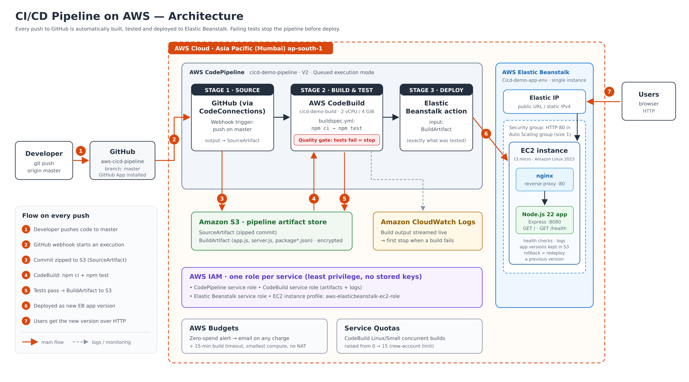

# 🚀 CI/CD Pipeline on AWS (CodePipeline · CodeBuild · Elastic Beanstalk)

Every push to this repository is automatically **built, tested and deployed** to AWS Elastic Beanstalk with no manual steps. If a test fails, the pipeline stops and the broken code never reaches the live app.



## Highlights

- **Automated trigger:** a GitHub App connection (AWS CodeConnections) starts the pipeline on every push to `master`.
- **Build & test stage:** CodeBuild runs `npm ci` and the Jest + Supertest test suite in a clean container, using `buildspec.yml`.
- **Quality gate:** failing tests fail the Build stage, so Deploy never runs.
- **Automated deploy:** the tested **BuildArtifact** becomes a new Elastic Beanstalk application version (Node.js 22 on Amazon Linux 2023).
- **Push to live in about 3 minutes** in my tests.
- **Least-privilege IAM roles** per service, with no AWS keys stored anywhere.

## Pipeline

| Stage | Service | What happens |
|-------|---------|--------------|
| Source | GitHub via CodeConnections | Webhook on push to `master` → commit zipped to S3 (SourceArtifact) |
| Build & Test | AWS CodeBuild | `npm ci` → `npm test` → package app files (BuildArtifact) |
| Deploy | AWS Elastic Beanstalk | New application version deployed; nginx :80 → Node app :8080 |

## Tech stack

Node.js 22 · Express · Jest · Supertest · AWS CodePipeline (V2) · AWS CodeBuild · AWS Elastic Beanstalk (EC2) · Amazon S3 · AWS IAM · Amazon CloudWatch Logs

## Repository layout

```
app.js          Express app (GET / and GET /health)
server.js       Starts the server on PORT or 8080
app.test.js     Automated tests (Jest + Supertest)
buildspec.yml   CodeBuild instructions
docs/           Architecture diagram + screenshots
```

## Run locally

```bash
npm install
npm test        # runs the test suite
npm start       # http://localhost:8080
```

## Screenshots

| | |
|---|---|
| Pipeline: all stages green |  |
| Live app |  |
| Auto-deploy triggered by a git push |  |
| Live app updated after push |  |
| Quality gate: failing test stops the pipeline |  |

## Challenges & lessons learned

- **CodeBuild quota was 0 on a new account** (`AccountLimitExceededException`). I found it in Service Quotas (applied 0 vs default 1) and requested an increase, which was approved.
- **Deploy failed: missing `elasticbeanstalk:CreateApplicationVersion`.** The console-created pipeline role had no Elastic Beanstalk permissions. I attached `AdministratorAccess-AWSElasticBeanstalk` to unblock it; for production I'd replace it with a least-privilege custom policy.
- **Avoided a VPC trap:** running CodeBuild inside the default VPC would have cut off internet access (no NAT gateway), so `npm ci` would fail.
- **Branch mismatch:** the repo's branch was `master`, not `main`. The source config and webhook filter have to match.
- **Build/runtime parity:** aligned the build image and Elastic Beanstalk on Node.js 22.

## Next steps

Staging environment + manual approval · separate test stage with reports · load-balanced environment with zero-downtime (immutable) deploys · HTTPS via ACM · failure notifications via SNS · Infrastructure as Code (CloudFormation/Terraform).

## Cost

Single-instance Elastic Beanstalk (free-tier-eligible size), smallest CodeBuild compute with a 15-minute timeout, no NAT gateway, and an AWS Budgets zero-spend alert. The environment is terminated when not demoing.
